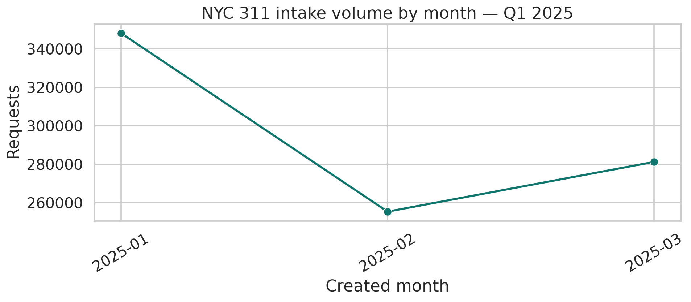
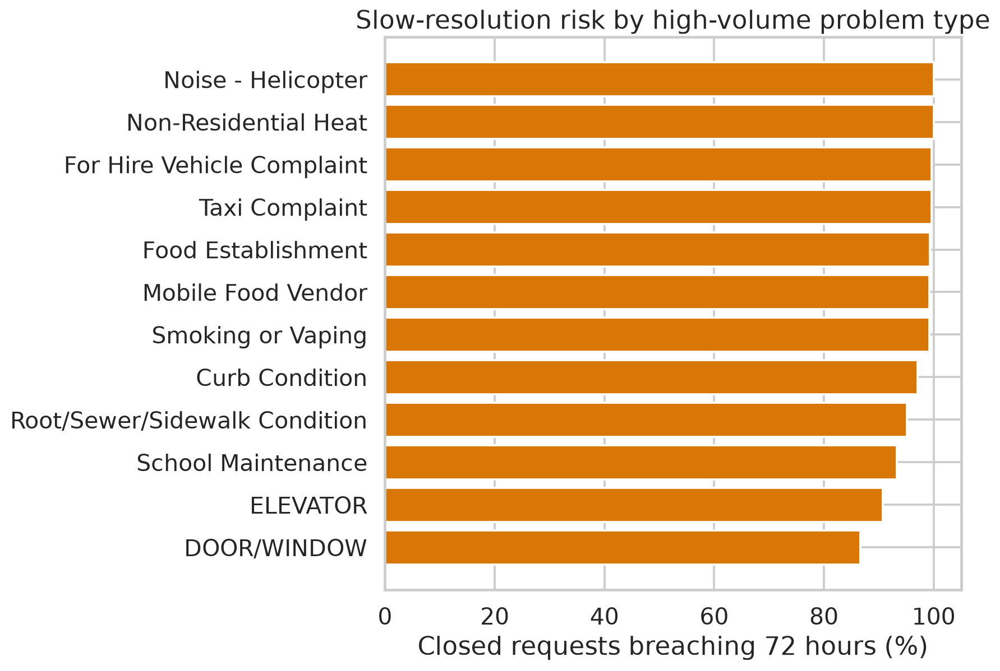
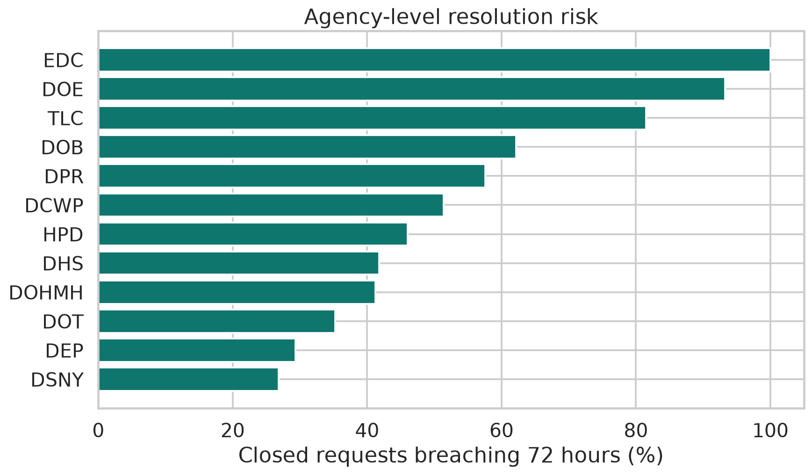
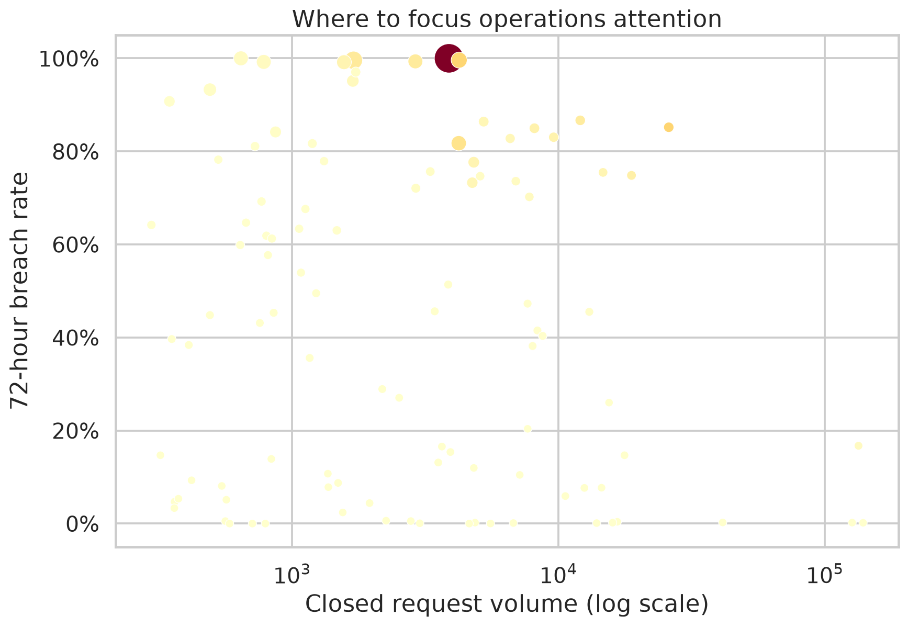
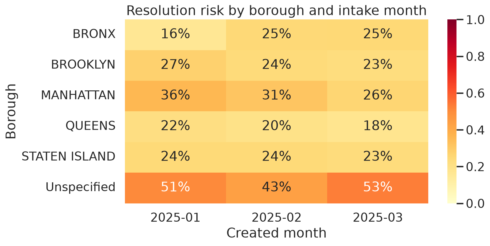

# NYC 311 Operations: Finding the Work Queues That Need Attention

**Role demonstrated:** Data Analyst / Operations Analyst  
**Tools:** Python, pandas, scikit-learn, seaborn, SQL  
**Source:** [NYC OpenData 311 Service Requests from 2020 to Present](https://data.cityofnewyork.us/Social-Services/311-Service-Requests-from-2020-to-Present/erm2-nwe9)

## The business problem

A city service operation can close most requests quickly while still carrying expensive long-tail work. Leaders need a defensible answer to three questions:

1. Which request types generate the most workload and slow-resolution risk?
2. Which agencies, boroughs, and intake patterns should receive operational attention first?
3. Can intake-time information help triage new requests before the outcome is known?

This case study uses **884,765 real NYC 311 service requests created in Q1 2025**. The source is maintained by NYC OpenData and updated daily. It does not contain personally identifying information according to the source description.

## What the analysis found

The extract contains **873,833 valid closed requests** and **10,932 requests without a valid closed record**. The median closed-request resolution time is **12.6 hours**, but the 90th percentile is **437.5 hours**, showing a very long operational tail. Using a transparent 72-hour triage threshold, **23.7% of closed requests breach the threshold**.

The queue is not uniform. HPD accounts for **246,365 closed requests** and has a **46.0% 72-hour breach rate**, making it a large operational opportunity. The `UNSANITARY CONDITION` category has **25,931 requests** and an **85.2% breach rate**. These results point to a combined strategy: address high-volume agency workload while creating specialist workflows for high-risk problem types.

The temporal model adds an early-warning layer. A logistic-regression model trained on January–February intake data and evaluated on March data achieved **ROC-AUC 0.946** and **average precision 0.833**. It uses only fields available when a request is created, so the output can be used as a triage score rather than as a retrospective explanation.



## Operational recommendations

### 1. Build two queues instead of one

Use a **volume queue** for high-throughput work such as HPD and a **risk queue** for request types with high breach rates or unusually long tails. Combining both avoids the common mistake of prioritising only the slowest category, which can overemphasise low-volume outliers.

### 2. Pilot targeted triage for high-risk intake types

Use the March risk score to route likely 72-hour breaches for earlier review. Start with categories such as unsanitary conditions, building/use, door/window, plumbing, and water leaks, then compare breach rate and resolution time against a holdout group. The model is a prioritisation aid, not proof that a particular intervention causes faster closure.



### 3. Monitor agency-specific workflow differences

Agency comparisons are materially different. NYPD closes most requests quickly in this extract, while HPD, DOB, DPR, and TLC show much higher long-tail risk. The next operational step is not to rank agencies as good or bad; it is to investigate whether the difference reflects case complexity, handoffs, staffing, escalation rules, or timestamp conventions.



### 4. Track a transparent priority score

The project creates a repeatable complaint-level score:

`request volume × 72-hour breach rate × median resolution hours`

This makes the trade-off visible. A category with high volume and moderate risk may deserve more capacity than a tiny category with a 100% breach rate. The score should be refreshed weekly and reviewed with operations leaders.



## Method

The analysis parses timestamps, removes negative resolution durations from duration metrics, standardises missing categorical values as `Unknown`, and keeps the raw extract unchanged. The 72-hour threshold is an explicit analytical assumption, not an official NYC SLA. The model uses a temporal holdout to reduce leakage: January–February for training and March for evaluation. Full decisions and limitations are documented in [`docs/methodology.md`](docs/methodology.md).



## Reproducibility

```bash
pip install -r requirements.txt
python src/download_data.py
python src/analyze.py
```

The source extract is large, so the repository includes the download script and a small sample rather than relying on a GitHub-hosted copy of the full 213 MB file. The official NYC OpenData source remains the system of record.

## Limitations

This is observational administrative data. A long closure time may reflect legitimate investigation complexity, missing timestamps, agency workflow, or data updates after the request was created. The model has strong holdout discrimination, but predictive performance does not establish causality. A production rollout should use a controlled pilot with service-level definitions agreed with each agency.
